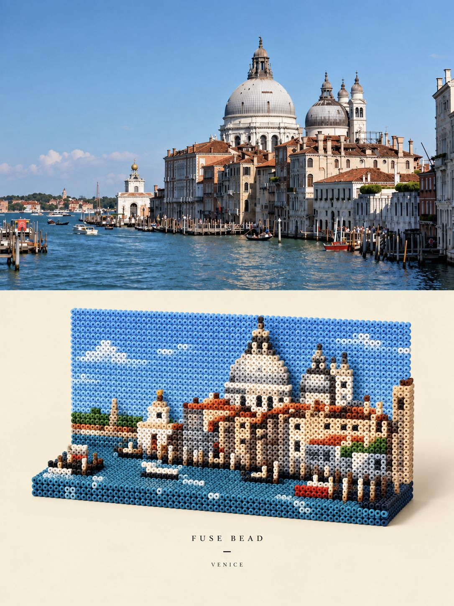

# 旅行拼豆纪念册 · Travel Bead Souvenir

从旅行照片中，提炼值得被记住的场景。

一套将照片转译为拼豆纪念图像的 Agent Skill：分析主体与空间关系，选择平面、异形、半立体或立体的表现方式，再通过色彩简化、圆孔材质和留白建立系列视觉。

*An Agent Skill for translating travel photographs into fuse-bead souvenir imagery, with photo analysis, material rules and scene-specific composition.*

## 案例：威尼斯水城



这张既有试作展示了从照片到拼豆图像的转译：保留穹顶、滨水建筑、船只与蓝色水面等识别线索，用前后层次组织空间，并以圆孔、厚度和接触阴影建立拼豆的材料感。

**示例说明：** 下方为 AI 生成的视觉概念，未经过实体拼豆制作。图片保留早期试作的标题；当前 Skill 默认不添加装饰性文字。

## 我的工作

**Yimeng Cheng / 程艺萌 · 创意方向、视觉规则与 Skill 工作流设计**

- **确定转译方向：** 从旅行影像中提炼主体、关键配色与空间线索，将照片内容组织成具有纪念物感的图像。
- **制定形式判断：** 根据场景选择平面、异形、半立体或立体处理，避免把所有照片套入同一种构图。
- **编写视觉与提示词规则：** 将拼豆圆孔、材料厚度、轮廓、色彩简化和留白要求整理为可复用的文件。
- **组织质量检查：** 对照输入照片检查主体、材质、空间逻辑与系列关系，并据此调整生成要求。

本项目将设计判断组织为**可复用的 AI 图像创作流程**；图像生成由运行环境中的图像工具完成。

## 设计方法

| 判断环节 | 方法 |
| --- | --- |
| 主体提炼 | 保留人物、动物、地标或关键物件，简化无关的背景细节。 |
| 形式选择 | 依据原图的图形性与空间深度，选择平面、异形、半立体或立体表达。 |
| 材料表达 | 明确圆柱珠体、中心圆孔、排列节奏、厚度与接触阴影。 |
| 系列组织 | 以 3:4 画幅、暖奶油底色与材料感建立统一性，让主体尺度与构图随场景变化。 |

## 工作流

**分析照片 → 选择拼豆形式 → 提炼主体与颜色 → 组织构图和提示词 → 图像生成 → 对照检查**

当前规则要求上方保留输入照片、下方呈现拼豆视觉，并默认省略装饰性文案。制作系列时统一材料与版式气质，同时允许每张图采用不同的主体尺度和空间处理。

## 安装与使用

在支持 Agent Skills 的环境中，将仓库文件放入项目的：

```text
.agents/skills/travel-bead-souvenir/
```

确保入口位于 `.agents/skills/travel-bead-souvenir/SKILL.md`，并保留 `references` 目录。

上传照片后调用：

```text
使用 $travel-bead-souvenir，把这张旅行照片转化为拼豆纪念册图像。
保留原始照片，根据主体与空间关系选择合适的拼豆形式。
```

或：

```text
Use $travel-bead-souvenir on this travel photo.
```

实际图像生成需要可用的图像生成或编辑工具。没有图像工具时，该 Skill 输出适合当前照片的生成提示词，不会声称已经完成图像编辑。

## 文件结构

```text
travel-bead-souvenir/
├── README.md
├── SKILL.md
├── LICENSE
├── references/
│   ├── visual-rules.md
│   └── prompt-template.md
└── docs/images/
```

- [`SKILL.md`](SKILL.md)：照片分析、形式选择、生成流程与质量检查。
- [`visual-rules.md`](references/visual-rules.md)：详细视觉要求。
- [`prompt-template.md`](references/prompt-template.md)：可复用的提示词结构。
- `docs/images/`：既有视觉试作。

## License

Skill 文本与规则文件采用 [MIT License](LICENSE)。示例图用于展示视觉转译过程；输入照片与其中出现的作品不因该许可转让权利。

## 其他创意实验

- [林间布语 · Stitch Soft Forest](https://github.com/YimengCheng/stitch-soft-forest)
- [圣诞树交互网页 · Christmas Tree 2025](https://github.com/YimengCheng/Christmas-Tree-2025)
